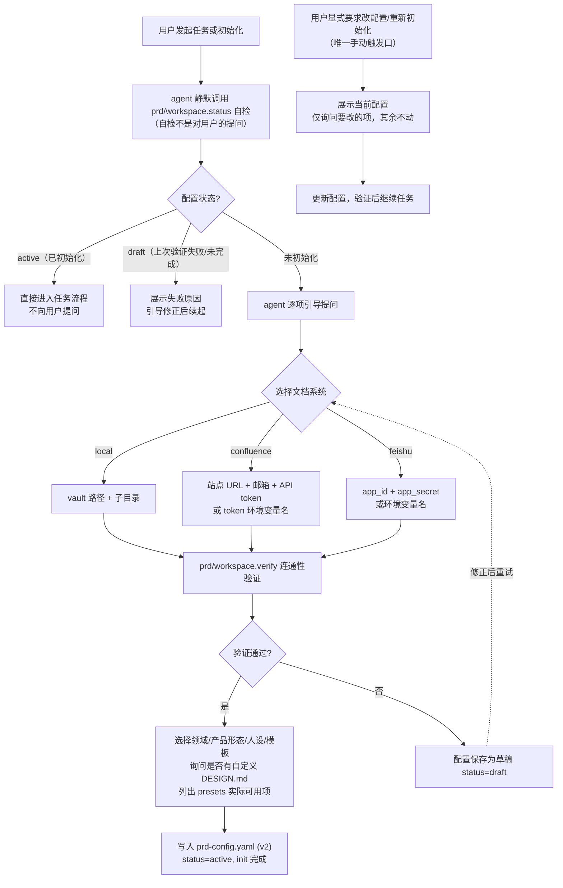
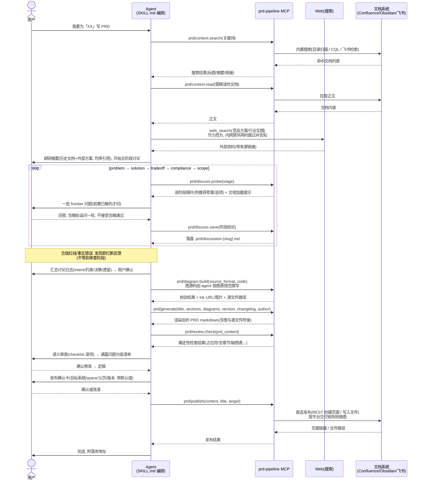

# prd-pipeline 需求文档

> **唯一需求源**：本文档由原 `PLAN.md`（实施计划）与 `REQUIREMENTS-v2.md`（澄清基线）合并而成，两者已停用并移除。
> 状态：**待 review**（v2.1）

## 修订记录

| 版本 | 时间 | 修订内容 | 修订人 |
|------|------|---------|--------|
| v1.0 | 2026-08 | 原 PLAN.md — 实施计划（开发者视角，P0/P1/P2 任务驱动） | 李昊男 |
| v2.0 | 2026-09-03 | 重新澄清需求基线：确立内置直连架构方向、跑通标准、三系统目标 | 李昊男 |
| v2.1 | 2026-09-03 | 合并 PLAN.md；按 17 项审查问题修订：补产品流程图、工具变更映射、测试策略、配置迁移、迭代 PRD 规则、presets 自定义等 | 李昊男 |
| v2.2 | 2026-09-03 | 修正初始化流程：已初始化用户静默自检直接进入任务，不主动询问调整；配置调整改为用户显式触发支线。§4.5 补知识分层设计（presets/config/agent memory 各自职责） | 李昊男 |
| v2.3 | 2026-09-03 | 主流程下钻修订：调研增加 web_search 编排；图表体系重构为引擎可插拔（diagram.build 替代 flowchart/sequence，12 tools）+ 平台交付矩阵；新增合规 preset（第四类）与产品形态选择；新增通篇 AI 预审（review.check）与反馈协议；新增发布确认卡 | 李昊男 |
| v2.4 | 2026-09-03 | 增加终局愿景：产品工作台（前端界面）；明确短期形态 = 纯 MCP 插件，界面为远期演进方向，并给出架构不锁死的前瞻约束 | 李昊男 |
| v2.5 | 2026-09-03 | 图表选型下钻：流程图默认 mermaid + drawio 精修（官方 Mermaid 导入、.drawio.png 内嵌 XML 兼顾 Confluence 兼容与二次编辑）；新增原型图方案 = HTML 线框（保真度可控）+ 导入 Figma/MasterGo 精修（官方导入链路）；ProcessOn 不作依赖 | 李昊男 |
| v2.6 | 2026-09-03 | init 增加自定义 DESIGN.md 询问项；吸收 grill-me 探针机制（frontier 批量提问 + 推荐答案 + 追问协议）与讨论结论落盘；吸收 ponytail 最小必要原则（三问准入 + 不可裁剪例外）；§6.3 改造为 backlog 登记表；html adapter 消费契约补全（DESIGN.md token 注入） | 李昊男 |

> **工具计数口径**：原 11 个 → 移除 `diagram.flowchart`/`diagram.sequence`（合并废弃）、新增 `diagram.build`/`workspace.verify`/`context.read`/`review.check`/`discuss.save` = **13 个**

---

## 一、背景与定位

### 1.1 项目现状

- 2026-08 按原 PLAN.md 完成代码：11 个 MCP 工具，~1,700 行 TypeScript
- **从未端到端跑通**：任何 MCP 客户端都未配置过此 server，"跑通"止步于代码写完
- 构建与单元测试通过（npm build / 34 tests），问题不在代码能否编译，而在**产品闭环从未被验证**
- 运行时冒烟测试已确认若干实现层缺陷（generate 章节契约错位、mermaid.ink 编码 400 等），详见 §4.3 / §4.6 与后续 review 报告

### 1.2 为什么重审

原 PLAN.md 是开发者视角（P0 工具清单驱动），本版改为**用户旅程驱动**（安装 → 对接 → 使用 → 落库）。大的思路不变：

```
Agent (SKILL.md) 编排  +  prd-pipeline MCP 工具层  +  presets 领域知识
```

三层架构保留，工具职责基本保留，重点校准"对接文档系统"这一核心能力的实现方式。

### 1.3 产品定位

- **开源的 PRD 工作流插件**，面向所有 MCP 客户端用户（Claude Desktop / Cursor / Claude Code / VS Code / Hermes 等）
- 作者本人作为 **dogfooder** 在真实工作中使用，反馈驱动持续迭代
- 与作者本机的 prd-workflow skill（Hermes 私有沉淀）是**两个独立项目，不合并**
- **语言定位**：默认中文优先（探针库、模板、领域知识均为中文，面向中文社区发布）；英文支持列入 backlog 待定 → **决策点 D5**

### 1.4 产品形态：短期插件，终局工作台

| 阶段 | 形态 | 说明 |
|------|------|------|
| **短期（现在）** | 纯 MCP 插件 | 装进任意 agent 即用；所有交互通过 agent 编排完成（引导、讨论、审查、确认卡都发生在对话里） |
| **终局（愿景）** | 产品工作台 | 在 MCP 工具层之上加前端界面：PRD 列表与状态、讨论历史回放、图表预览编辑、发布目标管理、审查问题面板——"产品经理的工作台"体验；对话（agent）与界面（工作台）长期共存互补，不是替代关系 |

**演进原则（对短期实现的约束，避免终局返工）**：

1. **状态全部落盘**：workspace 状态、讨论结论、PRD 版本、审查结果都持久化为文件/结构化数据（config、PRD 文件、可能的 `.prd/` 状态目录）——界面随时可以读同一份状态来渲染，不依赖对话内存
2. **工具返回结构化 JSON**：所有工具返回机器可读数据（本次冒烟测试已验证此风格），前端可直接消费
3. **编排逻辑不写死在工具里**：多步引导、确认卡等交互由 SKILL.md 编排，工具保持无状态分步——未来界面接管这些交互时，调同一组工具即可
4. MCP 协议本身支持 resources/notifications 等界面所需能力，演进路径无需更换协议层

---

## 二、目标与用户

### 2.1 用户与核心场景

| 用户 | 场景 | 诉求 |
|------|------|------|
| 开源用户（首要） | 装好插件首次使用 | 引导式 init：不读源码、不看文档也能完成全部配置与对接 |
| 开源用户 | 日常写 PRD | 一次对话内：调研 → 五阶段讨论 → 生成 → 发布落库 |
| 作者本人 | 真实工作（fintech PRD） | 同上，且 Confluence/Obsidian/飞书三系统按需切换 |

### 2.2 跑通标准（本项目的"量化目标"）

- **a. 初始化可达**：新用户从克隆/npx 到 init 完成（含文档系统对接 + 连通性验证），全程由 agent 引导，不要求读源码
- **b. 主流程可达**：init 完成后，agent 引导用户走完 调研 → problem → solution → tradeoff → compliance → scope → 生成 → 发布，最终 PRD 落进用户指定的目标系统

### 2.3 成功度量

- 本阶段以**功能验收**为主（§九 AC1–AC5）
- 开源运营指标（star / 安装量 / issue 响应时效）**显式列为非目标**，不作为本阶段验收依据；产品可用后再评估

---

## 三、产品流程

### 3.1 初始化流程（引导式 onboarding）



**引导触发原则**：`workspace.status` 是 agent 的静默自检，不是对用户的提问。引导流程只在两种情况下出现——配置缺失/未通过验证（自动触发），或用户明确要求查看/修改配置（手动触发）。配置齐全时 agent 直接干活，绝不周期性打扰。

### 3.2 常规使用流程（主流程时序）



---

## 四、需求详述

### 4.1 需求 1：引导式初始化（本次改造核心之一）

`prd/workspace.init` 从"一次性配置写入"升级为**引导式 onboarding 流程**：

1. **选择文档系统**：`local`（Obsidian vault / 任意目录）/ `confluence` / `feishu`，用户指定
2. **收集对接凭证**（按所选系统，见 §4.2）
3. **连通性验证**（init 关卡，新增工具 `prd/workspace.verify`）
4. **选择领域 / 产品形态 / 人设 / 模板**：列出 presets 中**实际可用**的选项（扫描 `presets/` 目录 + 用户自定义目录，替代当前硬编码列表）
5. **询问自定义 DESIGN.md**：是否有公司/个人的设计 token 文件（Google DESIGN.md 格式）？
   - 有 → 记录路径至 config `prototype.tokens_path`，原型图生成时注入其 token
   - 无 → 使用 plugin 内置中性默认 token；并在引导中告知"可后续用 design-md 方法论/官方 CLI 生成后配置"

**职责边界（Q6）**：引导逻辑由 SKILL.md 编排，**不在 server 内做状态机**；但每个工具是无状态分步接口——入参校验失败时返回结构化错误 + 下一步提示，保证编排能力弱的 MCP 客户端也能按步骤走通。

**验证失败行为（Q7）**：
- 验证失败时配置仍保存，`status: draft`（部分初始化合法）
- `prd/workspace.status` 返回 `verification: passed | failed | pending` 与失败原因
- agent 引导用户修正凭证后重试 verify；无需跨会话内存——状态都在配置文件里，下次会话从 status 续起

### 4.2 需求 2：内置文档系统直连（架构决策，已拍板）

**决策**：插件内置 HTTP 客户端，自己完成对接与发布，**不依赖用户另配文档类 MCP server**。

| 目标系统 | 实现方式 | 发布行为 | 可用定义 |
|----------|---------|---------|---------|
| Confluence | 内置 REST 客户端（email + API token，Basic Auth） | 创建页面 / 子页面（迭代 PRD 挂 parent），Storage Format 正文 | 能创建页面且图片正确嵌入 |
| 飞书 | 内置开放平台客户端（tenant_access_token 自动刷新） | 创建新版 docx 文档到指定文件夹，写入块结构 | 能创建文档、写正文、**上传图片**（终态定义，下一轮实现，范围随 D1） |
| local | 本地文件写入 | Markdown 落入 vault 约定目录 | 能落文件且路径符合用户配置 |

**凭证存储（Q9）**：
- 凭证存入 `prd-config.yaml`（已 gitignore）；同时支持引用环境变量名（`token_env` / `app_secret_env`）
- **解析优先级**：环境变量名引用 > 明文值；env 引用解析失败时在 verify 阶段报明确错误
- **对话通道风险**：在聊天中粘贴 token 会进入对话历史/客户端日志——init 引导文案必须提示"敏感环境建议用环境变量名引用"；README 醒目警示明文存储风险

**local 目录约定（Q8）**：init 时收集 vault 路径 + **子目录**（默认 `PRD/`，可自定义）；发布写入 `<vault_path>/<subdir>/`；文件命名沿用现有规则（日期-标题-版本）。

**旧"指令模式"回退（Q15，D2 采纳选项②）**：当目标系统为 confluence/feishu 但**未配置凭证**时，publish 自动回退为现有指令模式（生成 HTML + 指引 agent 调用用户自配的文档 MCP）。回退模式下内置搜索/精读不可用，返回提示说明。凭证齐全时走直连，不做运行时切换开关（减少状态组合）。

### 4.3 需求 3：主流程工具保持与变更映射（Q2）

`discuss.probe`、`template.*`、`diagram.*`、`generate`、`publish` 职责与编排顺序不变。工具级变更全景：

| 工具 | 处置 | 变更内容 |
|------|------|---------|
| `prd/workspace.init` | 改造 | 分步引导参数、凭证收集、`status: draft/active`、config v2 |
| `prd/workspace.status` | 改造 | 增加 verification 状态与失败原因 |
| `prd/workspace.config` | 保持 | 支持 credentials / preset_dirs 更新 |
| `prd/workspace.verify` | **新增** | 连通性验证关卡（§4.1） |
| `prd/context.search` | 改造 | local 保持；confluence 内置 CQL（契约见下） |
| `prd/context.read` | **新增** | 按 page_id/url 拉取 Confluence/飞书文档正文 |
| `prd/discuss.probe` | 改造 | **grill-me 式探针**：每题附推荐答案/典型选项（供反对而非空白填空）；返回该阶段 frontier 问题包 + 合规加载提示（产品形态+领域叠加，§4.5）；探针库同步扩充选项字段 |
| `prd/discuss.save` | **新增** | 讨论结论落盘：每阶段结论追加写入 `.prd/discussion-<slug>.md`（Intent/Constraints/Key decisions/Surfaced assumptions/Open questions）；作为 generate 输入与审查依据（工作台演进：状态落盘原则） |
| `prd/template.list/get` | 改造 | 扫描内置 + 自定义 preset 目录 |
| `prd/diagram.build` | **新增（合并替代）** | 引擎可插拔图表管道（§4.6）；替代原 `diagram.flowchart` / `diagram.sequence`（**废弃**） |
| `prd/review.check` | **新增** | 通篇 AI 预审的确定性检查项（§4.7）；语义审查由 agent 按 checklist 执行 |
| `prd/generate` | 修复+改造 | **sections 键与模板占位符对齐（已实测错位）**；校验并报告未匹配键；新增 `changelog`/`author` 填充修订记录（§4.4） |
| `prd/publish` | 改造 | 直连发布 + local 目录约定 + 迭代 PRD parent 规则（§4.4）+ 平台交付矩阵（§4.6）+ 发布前确认卡由 SKILL.md 编排（§4.8） |
| ConfluenceAdapter（指令模式） | 降级为回退 | 仅在无凭证时触发（§4.2） |
| 飞书适配器 | **新增** | 下一轮（范围随 D1） |

**CQL 搜索契约（Q13）**：返回字段固定为 `title / page_id / url / space / last_modified / excerpt`；参数 `limit`（默认 10）+ 可选 `space` 覆盖；空间范围默认取 config 中的 space，未配置时返回错误提示（不默认全站，避免越权扫描）。精读正文走 `prd/context.read`。

### 4.4 需求 4：迭代 PRD 与版本管理（Q3）

- **修订记录自动生成**：`prd/generate` 入参增加 `changelog`（修订内容）与 `author`（修订人），连同 `version` 自动填充模板修订记录表；缺失时填入占位符并提示
- **Confluence 迭代规则**：publish 带 `parent_id` 时直接创建子页；带 `parent_title` 时先按标题在 config space 内检索父页，**命中 0 个报错、多个返回列表让用户选、1 个直接挂载**；不自动更新父页正文（更新走显式 update 指令，本期非目标）
- **local 迭代规则**：文件名带版本号自然并存（`日期-标题-v1.1.md`）

### 4.5 需求 5：presets 与自定义（Q12）

- 内置 presets：`presets/domains|souls|templates/`（现状：fintech、2 个 soul、2 个模板）
- **自定义机制**：config 增加 `preset_dirs: []`，用户可指向自定义目录；目录结构须遵循 `domains/ souls/ templates/` 约定；template.list / workspace.init 的可选项 = 内置 + 自定义合并（同名时自定义覆盖内置，返回结果标注来源）
- 领域 / 人设 / 模板三者均允许自定义

**知识分层设计（明确各信息的归宿与理由）**：

| 信息 | 归宿 | 理由 |
|------|------|------|
| 可复用知识（领域知识 / 人设方法论 / 模板结构） | plugin 的 `presets/` 目录 | ① **架构决定**：MCP server 是独立进程，只能读文件系统——知识若存于 agent memory，`prd/generate` 等工具无法读取，"工具层封装"的架构即失效；② **确定性**：工具读文件是确定性的，memory 检索是概率性的，PRD 模板需要结构稳定，不能靠检索碰运气；③ **跨客户端可移植**：开源产品要求同一 plugin 在所有 MCP 客户端工作，memory 是客户端私有的（Hermes 的 memory Cursor 用户拿不到），presets 跟仓库走，装了就有；④ **可版本化、可分享**：presets 进 git，可 diff、可接受社区 PR 贡献新领域知识 |
| 用户的选择（选了哪个领域/人设/模板、文档系统及凭证） | `prd-config.yaml`（v2） | 持久化、可检查、跨会话的状态，正是 config 的职责 |
| 用户私有扩展（自写的公司领域知识等） | 自定义 preset 目录（`preset_dirs`） | 仍是文件（server 可读），但归用户所有，与内置同名可覆盖，不污染内置内容 |
| 对话内个性化（用户偏好、上下文习惯） | agent 的 memory | 仅作对话体验补充（如少问一句已知偏好）；**绝不是任何一层的 source of truth**——memory 丢失不影响产品工作，工具层永远以 config + presets 为准 |

**合规 preset（第四类，独立于行业与岗位）**：`presets/compliance/`

- **为什么不跟行业融合**：个保法/数据安全法是**法规维度**而非行业维度——C 端 fintech = 隐私合规 **+** 金融红线（征信、利率）；C 端电商 = 隐私合规 **+** 广告法。隐私要点跨行业复用，塞进行业文件会重复多份、维护漂移
- **为什么不跟岗位融合**：合规是"知识"（知道什么红线），soul 是"思维方式"（怎么思考），两者性质不同（§领域 vs Soul 边界）
- **加载规则**：`compliance 阶段与终审时 = 产品形态（c-end → c-end-privacy）+ 所选领域（fintech → 金融红线）` 两维度要点**叠加使用**，不互斥
- **init 联动**：初始化增加"产品形态"选择项（c-end / b-end），存入 config `workspace.product_form`
- 首个内置文件：`presets/compliance/c-end-privacy.md`（收集最小化、明示授权、权限申请时机、第三方 SDK 披露、账号注销与删除权、未成年人保护、个性化推荐关闭选项等审核要点）
- 行业红线仍留在各 `domains/*.md`（如 fintech 的 24%/36%、征信授权）；compliance 层放跨行业通用的法规要点

### 4.6 需求 6：图表体系——引擎可插拔 + 平台交付矩阵（Q14 / D4）

**设计原则（工具层可插拔是硬要求）**：画图引擎百花齐放（mermaid / draw.io / plantuml / d2 / excalidraw…），随时出新产品。图表体系按 **"agent 产图源码 + 工具层做引擎无关管道 + 引擎 adapter 注册表"** 分层：

```
Agent（按 SKILL.md 图表规范撰写图源码）          ← 生成职责在 agent（LLM 写 mermaid 强于正则解析）
    ↓ source_format + code
prd/diagram.build —— 引擎无关管道：
    校验（按引擎）→ 编码/渲染（按引擎 adapter）→ 落源文件 → 返回交付物
    ↓
diagram/adapters/{mermaid,drawio,...}.ts        ← 新引擎 = 新增 adapter，核心不动
```

- **本轮实现**：`mermaid` adapter（校验基本语法 + ink 编码修正为 plain base64url）
- **下一轮**：`drawio` adapter（.drawio XML + `.drawio.png` 内嵌 XML 导出）、`html` adapter（原型图线框）；plantuml/d2/excalidraw 等由社区按 adapter 接口扩展
- 原 `diagram.flowchart` / `diagram.sequence` 的正则生成逻辑**废弃**（实测解析质量差：节点合并、分支丢失）

**图类型选择矩阵（SKILL.md 编排规范）**：

| 表达内容 | 图类型 | 引擎 |
|----------|--------|------|
| 业务流程 / 判断分支 | flowchart | mermaid |
| 系统间交互 / 时序 | sequence | mermaid |
| 页面/状态流转 | state | mermaid |
| 方案对比 / 结构梳理 | mindmap | mermaid |
| 排期节奏 | gantt | mermaid |
| 复杂系统架构 / 网络拓扑 | drawio XML | drawio adapter（下一轮） |
| 界面原型 / 线框图 | HTML 线框（高保真，见 §4.6b） | html adapter（下一轮） |

**引擎选型依据——流程图/架构图（考虑 a 多平台兼容性 + b 源文件二次编辑）**：

- **默认源格式 = mermaid**：多平台兼容性最好（Obsidian/GitHub/聊天预览原生渲染；Confluence/飞书经交付矩阵转图片）；源文件是纯文本，天然可 diff、LLM 可直接再生成修改——二次编辑门槛最低的形态
- **精修/复杂架构 = drawio**：官方 drawio 支持**直接导入 Mermaid 并转为原生 drawio 形状**（Mermaid 源码附着在容器组上，可再编辑重生成；注：复杂样式转换有损，官方 issue #3884——简单图转换可靠）；`.drawio` XML 用 GUI 编辑，PM 无需语法知识
- **发布到 Confluence 的最优解 = `.drawio.png`（内嵌 XML）**：drawio 导出 PNG 时可 `--embed-diagram`——图片在 Confluence 正常显示，且**拖回 draw.io 仍可编辑**。兼顾"平台兼容"与"二次编辑"，比纯 mermaid.ink 截图多留住编辑能力（官方 drawio-mcp 提供 CLI 导出，5.3k star，Apache-2.0）
- **ProcessOn 不作为引擎依赖**：国内公司常用但格式私有、导入导出兼容性差，仅作为用户侧手动导出的可选目标，文档说明即可

**引擎选型依据——原型图（考虑 a 公司保真度要求 + b 源文件二次编辑）**：

- **结论：HTML 线框为源格式 + 导入用户设计工具精修为终态**。理由链：
  - agent 直接生成 .fig/.mastergo 原生文件**做不到**（格式私有）；Excalidraw 等低保真线框**达不到公司保真度要求**
  - **HTML/CSS 线框的保真度无上限**：真实组件、间距、真实文案，要多少保真有多少；且浏览器零依赖预览，截图即可嵌 PRD
  - **二次编辑通过导入链路解决**（均有官方证据）：Figma 用 **html.to.design** 插件（任意网页/HTML → 完全可编辑的 Figma 图层）；国内 MasterGo 有**官方 html-to-mastergo 库**（HTML → MasterGo 可编辑图层结构）；即时设计支持 Figma 文件导入（可从 Figma 转手）。PM 在自己熟悉的设计工具里精修——二次编辑门槛为零
- **plugin 职责**：html adapter 生成高保真 HTML 线框落 `assets/` + PRD 内嵌截图占位 + 附导入指引（Figma/MasterGo 各一行说明）；发布 Confluence/飞书时以截图形式嵌入（本地无头浏览器截图，P1 增强；此前由用户手动截图兜底）
- **设计 token 消费契约（DESIGN.md）**：html adapter 生成时读取 config `prototype.tokens_path` 指向的 DESIGN.md（Google 开放规范，YAML token + Markdown rationale），将 token 注入 CSS 变量——原型与用户公司设计系统一致，设计师精修成本最低。文件缺失时使用内置中性默认 token。**plugin 不内置 DESIGN.md 的编写/校验/导出工具链**（官方 CLI `npx @google/design.md` 与 design-md 方法论已覆盖，最小必要原则）；SKILL.md 指引用户可自行生成后配置。init 时询问用户是否有自定义 DESIGN.md（§4.1 第 5 步）

**美观与清晰要求（SKILL.md 图表规范）**：统一 themeConfig 配色；单图节点数受控（超限拆子图）；方向与布局选择指引；图必须有标题与连线语义（edge label）。

**平台交付矩阵（分平台，不假设原生渲染）**：

| 目标平台 | 图的交付形态 | 转换职责 |
|----------|-------------|---------|
| Obsidian / GitHub / 聊天预览 | mermaid 源码块**直接内嵌 PRD**（原生渲染即预览） | 无需转换 |
| Confluence | 自动转 mermaid.ink 图片，`<ac:image>` 嵌入 | publish 内置转换 |
| 飞书 | 图片字节（ink 下载或本地渲染），作为附件上传 | publish 内置转换 |
| ink 不可达（任一平台） | 保留源码块 + 提示用户本地渲染/截图 | 兜底 |

**源文件可修订（d 要求）**：mermaid 源码 = PRD 内嵌的代码块本身（天然附带、可 diff、配合 `%% ~~注释~~` 划线修订模式）；drawio 等外部引擎源文件落 PRD 同级 `assets/` 目录并在文档中附链接。

**渲染策略（数据外泄风险处置）**：将 PRD 图表内容编码进 URL 发给第三方 mermaid.ink，可能违反企业保密规定。渲染策略 config 项 `diagram.render`：
- `ask`（**默认**）：生成 ink URL 前由 agent 征求用户逐次确认
- `ink`：直接生成（个人/非敏感场景）
- `local`：仅返回源码块，提示本地渲染/截图（最保守）

**PRD 写作设计原则（吸收 grill-me / ponytail 哲学，指导 plugin 帮用户写 PRD 的过程）**：

1. **拷问式澄清（grill-me）**：agent 不接受用户的第一版模糊表述——通过 frontier 批量选择题 + 推荐答案 + 追问协议（见下），把用户"以为想清楚了"的需求逼到可判定、可执行、可测试；讨论结束的标志是 frontier 为空（没有遗留的隐性假设），而不是问满了固定问题数
2. **最小必要原则（ponytail）**：写进 PRD 的需求点默认从简——MVP 之外的都进"二期规划"而非塞进范围；方案描述写"必要且充分"的实现，不堆砌技术名词；数据埋点/报表只保留能支撑目标衡量的，不铺大而全。判断口径："如果砍掉这条，目标还成立吗？"——成立就砍
3. **两条原则的边界**：拷问是对用户的（帮他想清楚），最小必要是对 PRD 内容的（帮它瘦身）；合规红线不受最小必要约束——该披露的风险一条不能少（§4.7）

**grill-me 式讨论编排协议（SKILL.md 固化，借鉴 grill-me / ponytail skill 哲学）**：

1. **frontier 批量提问**：每阶段开始时呈现该阶段**前置已解决**的问题包（一批，不是 20 题轰炸也不是一题一挤）；后续问题依赖前面答案的，等答案到位再进入下一批
2. **推荐答案附着**：每条探针附 2-3 个典型选项 + 默认推荐 + 一句理由——给用户一个可反对的东西，比空白填空高效（探针库每条问题扩充选项字段）
3. **追问协议**：含糊回答（"都行""看情况"）必须追问一轮；不允许以"同意同意"通过——讨论产出质量取决于用户真实决策，不是问题数量
4. **结论落盘**：每阶段结束调 `prd/discuss.save` 追加写入 `.prd/discussion-<slug>.md`（Intent / Constraints / Key decisions / Surfaced assumptions / Open questions），作为 generate 输入、review.check 审查依据与工作台的状态源
5. **边界**：compliance 阶段涉及事实核查（法规红线），保持开放追问，不套选择题模板

### 4.7 需求 7：质量审查与反馈协议（新增）

**双层审查分工**：

| 层 | 执行者 | 检查内容 |
|----|--------|---------|
| 确定性检查 | `prd/review.check` 工具 | 残留占位符 `{xxx}`、必备章节为空、修订记录缺失/字段空、量化目标表缺失、全文无图、图源码未附 |
| 语义审查 | agent 按 checklist | 问题定义成立性、目标可量化、方案可执行可验收、合规红线（产品形态+领域叠加加载）、灰度与回滚完备、风险披露充分；checklist 源自 presets/compliance + 领域知识，SKILL.md 固化审查协议 |

- 审查时点：初稿完成后、发布确认前，**通篇 AI 预审**必过
- 产出：问题清单（位置 + 严重级别 P0/P1/P2 + 修改建议），用户确认修改、定稿后才进入发布确认卡

**反馈协议（审查项的反馈时机）**：

| 问题类型 | 反馈时机 | 理由 |
|----------|---------|------|
| 合规红线、事实性错误 | **发现即打断**（讨论阶段就反馈，不等审查） | 红线不即时指出，后续方案取舍会建立在违规设计上，事后返工是沉没成本 |
| 结构/清晰度/完整性等质量问题 | **通篇审查后一次性分级反馈** | 此类问题相互关联，需整体视角判轻重；碎片化逐条打断讨论心流 |

### 4.8 需求 8：发布确认卡（新增）

- **时机**：PRD 定稿后、执行发布前（不在对话开头问——用户此时还不知道产物长什么样；也不拖到发布动作瞬间——仓促）。用户确认内容之后弹卡，是"明确落库位置"与"不打扰"的平衡点
- **形态**：带默认值的确认卡，默认值全部来自 config（init 定的文档系统/路径）：
  ```
  发布确认：目标系统 = Confluence（默认）· space = FINT（默认）
            父页面 = 按标题检索「XX」或指定 · 版本 = v1.0
            改为 Obsidian / 飞书？回复即可
  ```
- Confluence space/父页、Obsidian 子目录是**每篇 PRD 可能不同**的项，确认卡一次呈现、可改可确认；迭代 PRD 的父页检索也在此步发生
- 常规流程仅此一次发布确认，不构成周期性打扰（与 §3.1 引导触发原则一致）

### 4.9 需求 9：安装与分发

- 保持 git clone + `npx tsx` 方式；npm 发布为 backlog 增强项
- 各 MCP 客户端配置指南（README）保持并随架构变更更新（移除 wiki-mcp 依赖描述）
- `skill/SKILL.md` 随仓库分发，承担 agent 编排指令，并按 §3 流程图重写

### 4.10 配置结构 v2 与迁移（Q5 / D3）

```yaml
version: 2
status: active                 # active | draft
workspace:
  domain: fintech
  product_form: c-end          # c-end | b-end（联动 compliance preset 加载）
  soul: c-end-pm
  template: standard
document_system:
  type: confluence             # local | confluence | feishu
  confluence:
    base_url: ""
    email: ""
    token: ""                  # 明文（风险自担）或改用 token_env
    token_env: CONFLUENCE_API_TOKEN   # 优先级高于 token
    space: ""
    parent_page_id: ""         # 迭代 PRD 默认父页（可选）
  feishu:
    app_id: ""
    app_secret: ""
    app_secret_env: FEISHU_APP_SECRET
    folder_token: ""
  local:
    vault_path: ""
    subdir: PRD
search:
  recent_spaces: []
  recent_keywords: []
diagram:
  render: ask                  # ink | local | ask
prototype:
  tokens_path: ""              # 用户自定义 DESIGN.md 路径; 空=内置中性默认 token
preset_dirs: []
```

- **迁移规则**：`readConfig` 检测 `version: 1` → 自动迁移（补充新字段默认值、`status: active`），不丢用户数据；迁移在内存完成后按需回写
- **已知限制（D3 采纳）**：config 固定在项目根目录，多项目共享需软链或等后续支持指定路径

---

## 五、架构与目录结构

```
Agent (SKILL.md)  ← 编排：引导、五阶段、图表规范、审查协议、发布确认卡
    │
prd-pipeline MCP Server (13 tools)  ← 能力：workspace / context / discuss / template / diagram / review / generate / publish
    │
├── src/clients/{confluence,feishu}.ts       ← 新增：内置 REST 客户端
├── src/adapters/{local,confluence-instruct}.ts
├── src/diagram/adapters/{mermaid,drawio}.ts ← 图表引擎注册表（可插拔）
├── presets/{domains,souls,templates,compliance}/
└── prd-config.yaml (v2, gitignored)
```

```
prd-pipeline/
├── REQUIREMENTS.md              # 本文档（唯一需求源）
├── package.json / tsconfig.json
├── src/
│   ├── index.ts                 # MCP 入口 + 工具注册
│   ├── types.ts / config.ts / writer.ts
│   ├── tools/                   # workspace / context / discuss / template / generate / diagram / review / publish
│   ├── clients/                 # [新增] confluence.ts / feishu.ts（HTTP 客户端）
│   ├── adapters/                # local.ts / confluence-instruct.ts（回退）
│   ├── diagram/
│   │   ├── ink.ts
│   │   └── adapters/            # [新增] mermaid.ts / drawio.ts（引擎注册表，可插拔）
│   ├── probes/
│   └── __tests__/               # 单测 + fixtures/
├── presets/
│   ├── domains/ souls/ templates/
│   └── compliance/              # [新增] c-end-privacy.md（第四类 preset）
└── skill/SKILL.md
```

---

## 六、范围与决策点

### 6.1 终态与节奏

- **终态**：三系统（local / Confluence / 飞书）全部可用，用户在 init 时指定
- **本轮范围**：待定 → **决策点 D1**。参考：飞书 API 复杂度显著高于 Confluence（token 刷新、块结构、图片上传），建议本轮 local + Confluence、飞书下一轮

### 6.2 决策点汇总

| # | 决策点 | 选项 | 建议 | 状态 |
|---|--------|------|------|------|
| D1 | 本轮改造范围 | ① local + Confluence，飞书下轮 ② 三系统一起 | ① | **待拍板** |
| D2 | 旧指令模式去留 | — | 保留为无凭证回退 | 已采纳进 §4.2 |
| D3 | config 位置 | — | 本轮固定项目根目录 | 已采纳进 §4.10 |
| D4 | mermaid 渲染策略默认值 | ink / local / ask | `ask`（确认制） | **待拍板**（默认值已写入 config） |
| D5 | 语言定位 | ① 中文优先，英文 backlog ② 双语 | ① | **待拍板**（默认已写入 §1.3） |

### 6.3 Backlog 登记表（原"非目标"改造——条目 + 重启触发条件，防止 later 变 never）

| # | 条目 | 类型 | 重启触发条件 |
|---|------|------|-------------|
| B1 | 产品工作台前端界面 | 终局愿景 | 插件被日常使用 ≥3 个月 / 社区出现界面需求 issue 热度 |
| B2 | drawio adapter | 下一轮 | mermaid adapter 稳定后下一迭代周期；或复杂架构图需求出现 |
| B3 | html adapter（原型图线框） | 下一轮 | 与 B2 同期评估；需求来自真实 PRD 场景 |
| B4 | 飞书适配器 | 依 D1 | 本轮范围若含飞书则升级为正式需求（M6） |
| B5 | npm 发布 | backlog | 架构稳定（M5 验收后）；或社区用户提出 npx 直装需求 |
| B6 | 英文预设与多语言文案 | 随 D5 | 出现海外用户 issue / star 来源国际化 |
| B7 | plantuml / d2 / excalidraw 引擎 adapter | 社区 | 社区 PR 贡献（按 adapter 接口） |
| B8 | 更多 preset（电商/教育/SaaS 领域，B端 soul，更多模板） | backlog | 社区 PR 或作者新领域需求 |
| B9 | 评审协作流程（review.submit）、版本 diff/log | 原计划 | 插件进入团队使用场景后 |
| B10 | Confluence 页面 update 指令化 | 本期仅创建 | 迭代 PRD 场景中出现"改已发布页"的真实需求 |
| B11 | 需求卡片对接（TAPD/Jira）、Figma 集成、插件市场、可视化面板 | 原 P2 | 工作台（B1）启动时一并评估 |
| B12 | 本地无头浏览器截图（原型图嵌入） | P1 增强 | html adapter（B3）落地后 |

**排除项（非 backlog，永久不做）**：与本机 prd-workflow skill 的任何合并；开源运营指标作为验收依据（§2.3）。

---

## 七、非功能需求

### 7.1 测试策略（Q4）

| 层级 | 范围 | 方法 | 环境 |
|------|------|------|------|
| 单元测试 | writer / config 迁移 / ink 编码 / generate 契约 / 探针库（含选项字段）/ discuss.save 落盘 | 纯函数直测 | CI 可跑 |
| 客户端测试 | Confluence/飞书 REST 客户端 | **mock HTTP**（注入 fetch 实现 / 录制 fixtures） | CI 可跑 |
| 集成测试 | 13 工具 stdio 全链路 | MCP 冒烟脚本（本次已建）入仓 | CI 可跑 |
| E2E 验收 | 真实 Confluence / Obsidian / 飞书 | 按 §九 AC 人工走查 | 作者环境 |

### 7.2 安全与凭证（Q9）

- prd-config.yaml 必须 gitignore（现状已满足，AC3 验证）
- 支持 env var 引用且优先级高于明文（§4.2）
- init 引导与 README 双处提示：对话粘贴 token 的日志风险、明文存储风险
- 凭证不写入任何工具返回值 / 日志输出（脱敏）

### 7.3 兼容与迁移（Q5）

- config v1 → v2 自动迁移（§4.8），旧配置用户升级无感
- 现有 34 个单测语义保持通过；vitest 需排除 `dist/` 重复收集（实现层已知问题）

---

## 八、风险与合规

| 风险 | 等级 | 缓解 |
|------|------|------|
| 凭证明文存于 prd-config.yaml，开源用户误提交 | 高 | gitignore 兜底 + env var 引用（优先）+ README 醒目警示 + init 引导提示 |
| **PRD 图表内容经 mermaid.ink 外发第三方（数据外泄）** | 高 | `diagram.render: ask` 确认制默认 + `local` 最保守档 + 远期本地渲染（§4.6） |
| 对话通道泄露 token（进对话历史/客户端日志） | 中 | 引导文案建议 env 引用 + 文档警示（§7.2） |
| mermaid.ink 外部依赖不可达 | 中 | mermaid 代码块兜底 + 提示本地渲染截图 |
| 企业内网 Confluence 网络（代理/VPN） | 中 | 直连客户端尊重系统代理环境变量；文档说明 |
| 飞书 API 变动/企业自建应用权限审核 | 中 | 下一轮处理；文档列明所需权限清单 |
| 生成的 PRD 质量依赖 agent 编排 | 低 | SKILL.md 持续打磨；用户 review 关卡内建（先展示后落库） |

---

## 九、验收标准（改造完成定义）

1. **AC1 初始化**：全新环境安装 → 客户端配置 → init 引导（含产品形态选择）→ 凭证收集 → 连通性验证通过，全程无源码阅读；验证失败可存草稿并续起
2. **AC2 端到端**：fintech 场景一次对话走完：历史文档搜索 + web_search 调研 → 五阶段讨论（grill-me 式 frontier 提问，结论落盘 `.prd/discussion-*.md`，C 端隐私合规要点叠加）→ 生成含图 PRD（图源码内嵌）→ 通篇预审（确定性 + 语义）→ 发布确认卡 → 发布。**分别验证**两个目标系统：(a) 发布到真实 Confluence 页面（迭代 PRD 挂子页，图转图片嵌入），(b) 发布到 Obsidian vault 约定目录（图原生渲染）；人工确认内容与图渲染正确（单次对话发布单目标系统，双发为后续增强）
3. **AC3 凭证安全**：`git status` 确认 prd-config.yaml 不入库；env var 引用方式可用且优先于明文
4. **AC4 单测**：现有测试语义保持通过，新增直连客户端（mock HTTP）、diagram.build 管道、review.check 确定性检查与 init/verify 关键路径测试；冒烟脚本入仓
5. **AC5 文档**：README 与 skill/SKILL.md 同步新架构（不再引用 wiki-mcp 依赖模式；含图表规范、审查协议、发布确认卡编排、渲染策略与凭证警示）

---

## 十、里程碑

| 里程碑 | 内容 | 对应原 PLAN |
|--------|------|------------|
| M1 初始化引导化 | workspace.init/status/config 改造（含产品形态 + DESIGN.md 询问）+ verify 新增 + config v2 + v1 迁移 + presets 扫描 | Sprint 1 + 需求 1 |
| M2 Confluence 直连 | REST 客户端 + publish 直连（平台交付矩阵）+ search(CQL)/read + 指令模式回退 | Sprint 2/3 + P1-1 提前 |
| M3 图表与生成链路 | diagram.build 引擎注册表（mermaid adapter + ink 编码修正）+ 废弃正则生成 + generate 契约对齐/修订记录 + local 目录约定 | Sprint 3 修复 |
| M4 质量审查与编排 | discuss.probe 探针库扩充（选项字段）+ discuss.save 落盘 + review.check 确定性检查 + presets/compliance（c-end-privacy）+ SKILL.md 重写（流程/grill-me 协议/图表规范/审查协议/确认卡）+ README 更新 + 凭证/渲染警示 | Sprint 4 + P0-10 |
| M5 端到端验收 | AC1–AC5 全量走查（作者真实环境 Confluence + Obsidian） | Sprint 4 验证 |
| M6 飞书适配 | 依 D1 定范围；按 §4.2"可用定义"验收（含图片上传） | 新增 |
| M7 drawio 引擎 | diagram adapter 第二实现（复杂架构图场景） | 新增 |

---

## 附 A：原 PLAN.md 内容去向

| 原 PLAN 条目 | 去向 |
|--------------|------|
| P0-1 ~ P0-10（脚手架 ~ SKILL.md） | 已实现；SKILL.md 重写列入 M4；架构描述并入本文档 §一/§五 |
| P1-1 Confluence 适配器 | 升级为内置直连，列入 M2 |
| P1-2 版本管理（diff/log）、P1-3 评审流程 | 非目标（§6.3） |
| P1-4 搜索习惯管理 | recent_spaces/keywords 保留于 config v2 |
| P1-5 更多 preset、P1-6 更多模板 | backlog（§6.3） |
| P2 全部 | 非目标/backlog（§6.3） |
| 优先级体系（P0/P1/P2） | 被"里程碑 M1–M6"替代 |

## 附 B：审查问题处置表（17 项）

| # | 问题 | 处置 | 落点 |
|---|------|------|------|
| Q1 | 缺产品流程图 | 已修 | §三 两张 Mermaid 图 |
| Q2 | 缺工具变更映射表 | 已修 | §4.3 |
| Q3 | 迭代 PRD/版本管理流程缺失 | 已修（方案待确认） | §4.4 |
| Q4 | 测试与验收策略不可执行 | 已修 | §7.1 |
| Q5 | 配置迁移策略缺失 | 已修 | §4.8 / §7.3 |
| Q6 | init 引导职责边界未定义 | 已修 | §4.1 |
| Q7 | 验证失败行为未定义 | 已修 | §4.1 |
| Q8 | local 目录约定缺失 | 已修 | §4.2 |
| Q9 | 凭证对话通道风险未覆盖 | 已修 | §4.2 / §7.2 / §八 |
| Q10 | AC2 表述自相矛盾 | 已修 | §九 AC2 |
| Q11 | 国际化范围未提 | **开放决策 D5**（默认中文优先） | §1.3 |
| Q12 | presets 自定义机制缺失 | 已修（方案待确认） | §4.5 |
| Q13 | CQL 搜索契约未定义 | 已修（方案待确认） | §4.3 |
| Q14 | mermaid.ink 数据外泄风险 | **开放决策 D4**（默认 ask） | §4.6 / §八 |
| Q15 | 指令模式回退条件未定义 | 已修 | §4.2 |
| Q16 | 飞书终态只有一行 | 已修（最小定义） | §4.2 可用定义列 |
| Q17 | 开源成功指标缺失 | 已修 | §2.3 显式非目标 |
