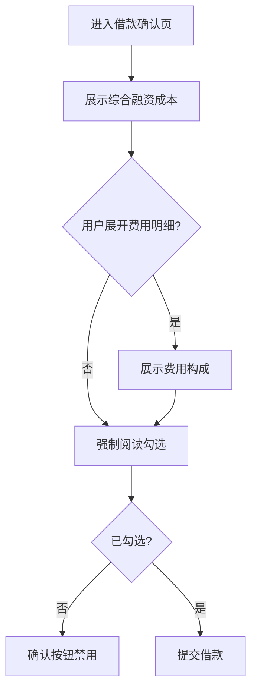

# 借款页综合融资成本明示优化

## PRD 修订记录

| 版本 | 时间 | 修订内容 | 修订人 |
|------|------|---------|--------|
| v1.0 | 2026-10-15 | 初版 | 李昊男 |

---

## 一、项目/需求背景

监管要求金融机构在借款确认前向借款人明示综合融资成本（IRR/APR）。当前借款页仅展示名义利率，用户对实际年化成本认知不足，存在投诉与合规风险；用户缺少统一口径的费用信息，易产生「低息诱导」的误解。

---

## 二、目标和收益

| 指标 | 当前值 | 目标值 | 衡量方式 |
|------|--------|--------|----------|
| 综合成本明示覆盖率 | 0% | 100% | 埋点 + 页面巡检 |
| 费用不透明类客诉 | 基线 | 下降 30% | 客诉分类统计 |
| 确认页有效阅读率 | 基线 | 提升 | 埋点 |

---

## 三、需求详述

### 需求列表
| # | 需求点 | 优先级 | 技术栈 | 备注 |
|---|--------|--------|--------|------|
| 1 | 借款确认页展示综合融资成本（IRR+APR） | P0 | 前端+服务端 | 统一口径来自费用中心 |
| 2 | 费用明细可展开，展示各费用项构成 | P0 | 前端 | 利息/服务费/担保费 |
| 3 | 强制阅读后方可点击「确认借款」 | P0 | 前端 | 阅读状态存服务端 |
| 4 | 文案与阈值走配置中心，支持灰度 | P1 | 服务端 | 热加载 |

### 交互说明
用户在确认页看到「本次借款综合年化成本 X%」，点击可展开费用明细；必须勾选「我已阅读并理解」后方可提交。异常场景：费用中心接口超时 → 展示兜底文案并禁止提交。

### 借款确认页合规明示流程

---

## 四、灰度方案

- 灰度维度：按 UID 尾号分桶，5% → 20% → 50% → 全量。
- 回滚方案：配置中心开关一键关闭，前端回退原展示。
- 合规红线不作为实验变量，所有组均需遵守。

---

## 五、合规/风险披露

### 合规审查
- 综合融资成本明示需覆盖全部费用项，口径与费用中心一致（金规〔2026〕2号）。
- 年化利率 IRR 不超过 24%；关键条款需强制阅读后方可继续。
- 征信授权与借款授权分离，不得捆绑同意。

### 资金风险
费用计算错误可能导致超额收取，需服务端二次校验并告警。

### 数据风险
用户费用数据属敏感信息，传输与存储需加密。

---

## 六、附录

- 关联 PRD：借款流程 v1.0
- 技术方案：费用中心统一口径改造
- 测试要点：费用口径一致性、强制阅读绕过、接口超时兜底

